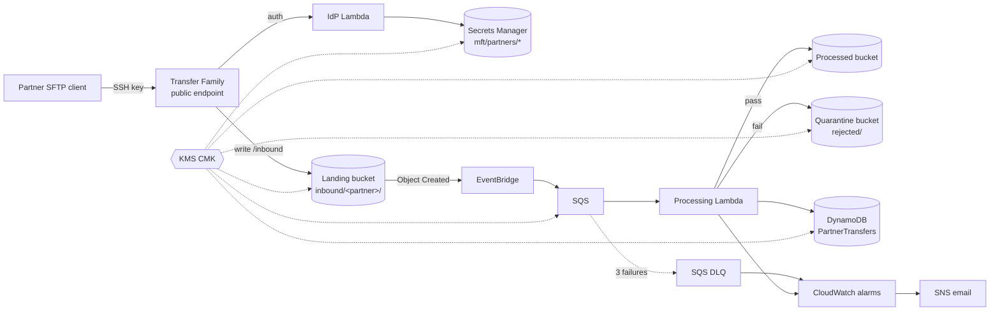

# MFT Hub

A managed file transfer (MFT) hub on AWS. Partners upload over SFTP (AWS Transfer Family) into a per-partner jail. Every file is validated, routed to `processed/` or quarantined in `rejected/`, and recorded in a DynamoDB audit table. Built with AWS CDK (TypeScript) and Python Lambdas, in `eu-central-2` (Zurich) for Swiss data residency.

> Status: **v1 complete (Phases 0 to 5).** Deployed and verified live in a real account; see [Verification](#verification). Design decisions live in [docs/DECISIONS.md](docs/DECISIONS.md), the build story in [AI_ENGINEERING_JOURNAL.md](AI_ENGINEERING_JOURNAL.md).

## Architecture



Two stacks (D9):

- **`MftCoreStack`** (persistent, close to free): KMS key, landing / processed / quarantine buckets plus an access-log bucket, partner records and the partner access role, the file pipeline (EventBridge rule, SQS queue and DLQ, processing Lambda, `PartnerTransfers` table), alarms, alert topic and the $10 monthly budget.
- **`MftSftpStack`** (ephemeral, ~$0.30/h): the Transfer Family server and its identity-provider Lambda. Deploy it for a demo, destroy it afterwards; nothing of value lives in it.

### What a partner sees

An SFTP login with an SSH key (no passwords) lands in a logical home with three folders (D20):

| Folder       | Access    | Backed by                               |
| ------------ | --------- | --------------------------------------- |
| `/inbound`   | write     | landing bucket `inbound/<PARTNER>/`     |
| `/processed` | read only | processed bucket `<PARTNER>/`           |
| `/rejected`  | read only | quarantine bucket `rejected/<PARTNER>/` |

A partner cannot see other partners, the bucket root, or delete anything.

### What happens to a file

The processing Lambda checks each upload (D5): path `inbound/<PARTNER>/<file>`, filename `<PARTNERID>_<YYYYMMDD>_<name>.<ext>` with a real date and the uploader's own ID, extension in `csv xml json pdf`, size between 1 byte and 100 MiB, and a magic-byte check of the first bytes. It records the SHA-256, copies the file to `processed/` or `rejected/` with `mft-status` / `mft-reason` tags, removes it from landing and writes the final status to `PartnerTransfers` (D6, D12).

Processing is idempotent per S3 object version (D30): a duplicate event is skipped, and a crash at any step is finished by the retry.

## Security controls

- **Identity:** SSH keys only, enforced by the server (`PUBLIC_KEY`) and again by the IdP, which also denies unknown, disabled and wrongly-cased users and checks optional source-IP allowlists (D4, D29).
- **Least privilege:** one partner role as the ceiling, narrowed per session by a generated policy to one partner's prefixes (D27, D28). Every Lambda has its own role with no AWS managed policies; KMS use is conditioned to the calling service where CDK allows it.
- **Encryption:** one customer-managed KMS key with annual rotation for S3, DynamoDB, SQS, SNS and Secrets Manager (D11). TLS-only bucket and queue policies, TLS 1.2 minimum on S3, `TransferSecurityPolicy-2025-03` on SFTP.
- **Buckets:** Block Public Access, owner-enforced ownership, versioning, server access logs and lifecycle rules (D19).
- **Confused-deputy protection** (`aws:SourceAccount` + `aws:SourceArn`) on every service principal: Transfer, EventBridge, Budgets and CloudWatch.
- **Gate:** cdk-nag (AwsSolutions) fails synth and CI; every acknowledgement is per finding and carries a reason (D22).
- **Secrets hygiene:** only public keys are committed; private demo keys live in gitignored `.keys/`. The alert email is passed at deploy time and never committed (D14).

## Cost

| Item                                           | Approx. cost                   |
| ---------------------------------------------- | ------------------------------ |
| Transfer Family SFTP endpoint (`MftSftpStack`) | ~$0.30 per hour while deployed |
| KMS key                                        | $1 per month                   |
| 2 partner secrets                              | ~$0.80 per month               |
| 4 CloudWatch alarms                            | ~$0.40 per month               |
| S3, DynamoDB on demand, SQS, Lambda, X-Ray     | cents at demo volume           |

A $10 monthly budget (D26) alerts at 50 / 80 / 100 % actual and 100 % forecast.

## Prerequisites

Node 22, Python 3.12, AWS CLI v2, OpenSSH (`sftp`) for the smoke test. Sign in with `aws login --profile mft-hub` (D8: short-lived credentials, no access keys). The account must be CDK-bootstrapped in `eu-central-2`.

## Build and test

```bash
npm ci
npm run build            # type check
npm run lint             # eslint + prettier
npm test                 # Jest CDK tests
npx cdk synth --strict   # synth; cdk-nag AwsSolutions findings fail it
npx cdk diff --profile mft-hub
```

Lambdas:

```bash
cd lambdas
python -m venv .venv && .venv/Scripts/pip install -r requirements-dev.txt   # bin/ on Linux/macOS
.venv/Scripts/python -m ruff check . && .venv/Scripts/python -m pytest
```

The CDK CLI is a pinned dev dependency, so always run it with `npx cdk`.

## Deploy

```bash
npx cdk deploy MftCoreStack --profile mft-hub -c alertEmail=<your address>   # confirm the SNS email once
npx cdk deploy MftSftpStack --profile mft-hub                                # only for a demo
scripts/smoke-test.sh                                                        # verify end to end
```

Always pass the same `alertEmail` when redeploying `MftCoreStack`, or CDK removes the subscription.

**Onboard a partner:** add an entry to `config/partners.json` (uppercase ID, name, OpenSSH public key, optional source IPs), open a PR, and redeploy `MftCoreStack` (D13). The private key stays with the partner.

## Operations

```bash
scripts/smoke-test.sh            # 3 SFTP uploads as ACMEBANK; asserts routing, tags, records, empty landing
                                 # (2 of its 3 files are rejected, so it also trips the rejected-rate alarm)
scripts/redrive-dlq.sh           # after fixing the cause of a DLQ alarm: replay the DLQ (idempotent, D30)
scripts/teardown.sh              # destroy MftSftpStack only (stops the hourly charge)
scripts/teardown.sh --all        # also destroy MftCoreStack; retained data stays, listed in .teardown/
scripts/teardown.sh --all --purge   # also delete retained data and schedule the KMS key for deletion
```

Add `--dry-run` to `teardown.sh` to print every command first. `--all` and `--purge` each ask for a typed confirmation. The scripts use `AWS_PROFILE=mft-hub` and `AWS_REGION=eu-central-2` unless set.

**Alarms** (`mft-hub-*`) notify the alert topic on ALARM and on OK: DLQ not empty, processor errors, processing queue stuck for over 1 hour, and more than 50 % of files rejected in an hour (once at least 3 files arrived) (D32).

**Observability** (D33): one JSON log line per file with the EventBridge event ID as `correlation_id`; metrics in the `MftHub` namespace (`FilesValidated`, `FilesRejected`, `FilesRejected` by `reason`, `ProcessingFailures`); X-Ray traces for the processor. To find every file rejected today, query the `status-index` GSI with `status = REJECTED`.

## Verification

Each phase was deployed and then checked live in the account; the evidence is in [docs/DECISIONS.md](docs/DECISIONS.md) ("Environment facts") and the journal. Highlights:

- SFTP: per-partner isolation, forbidden writes and deletes, `..` path tricks and wrong keys all denied (Phase 2).
- Pipeline: valid and invalid files routed with the right reasons, SHA-256 matching the local file, duplicates skipped (Phase 3).
- Alarms: the rejected-rate and DLQ alarms fired and cleared through the encrypted topic; a DLQ message was replayed with `redrive-dlq.sh` (Phase 4).
- Smoke test: `scripts/smoke-test.sh` passed all 9 checks over SFTP against a freshly deployed `MftSftpStack` (2026-11-11).
- Not yet verified: a real budget alert (needs spend over $5).

## Repository layout

| Path                        | Contents                                                                                                     |
| --------------------------- | ------------------------------------------------------------------------------------------------------------ |
| `bin/`, `lib/`              | CDK app (TypeScript). `lib/app.ts` builds the app and attaches cdk-nag; constructs in `lib/constructs/`.     |
| `test/`                     | Jest CDK assertion tests, including a canary that proves the cdk-nag gate fails on a non-compliant resource. |
| `lambdas/`                  | Python 3.12 Lambdas (`idp.py`, `processor.py`) and pytest + moto tests.                                      |
| `config/partners.json`      | Partner onboarding (public SSH keys only).                                                                   |
| `scripts/`                  | `smoke-test.sh`, `redrive-dlq.sh`, `teardown.sh`.                                                            |
| `docs/`                     | Decision log and AWS account setup guide.                                                                    |
| `AI_ENGINEERING_JOURNAL.md` | Per-phase log of AI-assisted work and human review.                                                          |

## CI

GitHub Actions (`.github/workflows/ci.yml`) runs on every PR and on `main`: CDK (type check, lint, Jest, `cdk synth --strict` with cdk-nag) and Lambdas (ruff, pytest with moto). Actions are pinned to commit SHAs, CI holds no AWS credentials, and deploys are manual (D7). Dependabot opens dependency updates (a 14-day cooldown is proposed in PR 11).

## License

MIT
