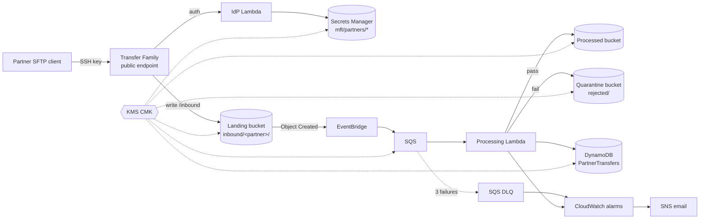

# MFT Hub

A managed file transfer (MFT) hub on AWS. Partners upload over SFTP (AWS Transfer Family) into a per-partner jail. Every file is validated, routed to `processed/` or quarantined in `rejected/`, and recorded in a DynamoDB audit table. Built with AWS CDK (TypeScript) and Python Lambdas, in `eu-central-2` (Zurich) for Swiss data residency.

> Status: **Phase 3 - file pipeline (EventBridge, SQS, processing Lambda, DynamoDB audit table).** Phases 1 and 2 are deployed. Design decisions live in [docs/DECISIONS.md](docs/DECISIONS.md).

## Architecture (target)



Two stacks (D9): `MftCoreStack` is persistent and close to free; `MftSftpStack` holds the SFTP endpoint (~$0.30/h) and is torn down after demos.

## Repository layout

| Path                        | Contents                                                                                                     |
| --------------------------- | ------------------------------------------------------------------------------------------------------------ |
| `bin/`, `lib/`              | CDK app (TypeScript). `lib/app.ts` builds the app and attaches cdk-nag.                                      |
| `test/`                     | Jest CDK assertion tests, including a canary that proves the cdk-nag gate fails on a non-compliant resource. |
| `lambdas/`                  | Python 3.12 Lambda code (`src/`) and pytest + moto tests (`tests/`).                                         |
| `config/partners.json`      | Partner onboarding (public SSH keys only).                                                                   |
| `docs/`                     | Decision log and AWS account setup guide.                                                                    |
| `AI_ENGINEERING_JOURNAL.md` | Per-phase log of AI-assisted work and human review.                                                          |

## Prerequisites

Node 22, Python 3.12, AWS CLI v2. Sign in with `aws login --profile mft-hub` (D8: short-lived credentials, no access keys).

## Commands

```bash
npm ci
npm run build        # type check
npm run lint         # eslint + prettier
npm test             # Jest CDK tests
npx cdk synth --strict   # synth; cdk-nag AwsSolutions findings fail it
npx cdk diff --profile mft-hub
```

Lambdas:

```bash
cd lambdas
python -m venv .venv && .venv/Scripts/pip install -r requirements-dev.txt   # bin/ on Linux/macOS
.venv/Scripts/python -m ruff check . && .venv/Scripts/python -m pytest
```

The CDK CLI is a pinned dev dependency, so always run it with `npx cdk`.

## CI

GitHub Actions (`.github/workflows/ci.yml`) runs on every PR and on `main`. It has two jobs: CDK (type check, lint, Jest, `cdk synth --strict` with cdk-nag) and Lambdas (ruff, pytest with moto). CI holds no AWS credentials, and deploys are manual (D7).

## License

MIT
